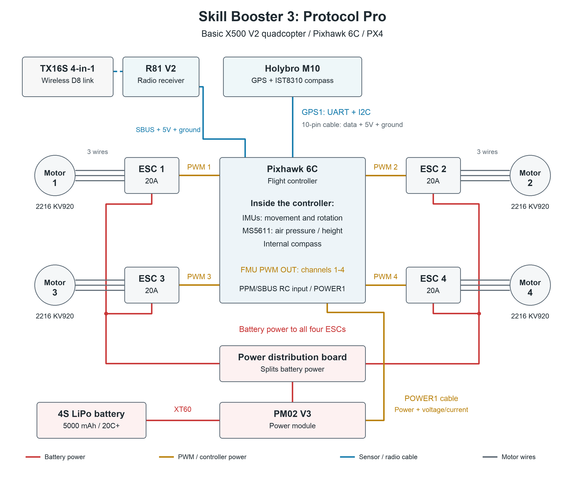

# Skill Booster 3: Protocol Pro

## My drone

I designed a basic quadcopter for practicing stable flight and GPS position hold. It uses an X500 V2 frame and a Pixhawk 6C flight controller running PX4. The flight controller reads the sensors and adjusts the four motors to keep the drone balanced.

## Parts

| Part | My choice | What it does |
| --- | --- | --- |
| Flight controller | [Holybro Pixhawk 6C](https://holybro.com/products/pixhawk-6c) | Reads sensors and controls the motors |
| GPS and compass | [Holybro M10, IST8310, standard 10-pin version](https://holybro.com/products/m10-gps) | Measures position and heading |
| Frame and propellers | [Holybro X500 V2](https://holybro.com/products/x500-v2-kits), four 1045 propellers | Holds the parts and provides lift |
| Motors and speed controllers | Four Holybro 2216 KV920 motors and four BLHeli S 20A ESCs from the [X500 V2 kit](https://holybro.com/products/px4-development-kit-x500-v2) | Each ESC controls one motors speed |
| Power system | Holybro PM02 V3 and the X500 power distribution board | Powers the controller and sends battery power to the ESCs. |
| Battery | 4S, 5000 mAh, 20C or higher LiPo with XT60 plug | Supplies power following the kits battery recommendation |
| Radio receiver | [RadioMaster R81 V2](https://radiomasterrc.com/products/r81-receiver) | Sends the pilots commands to the controller. |
| Handheld radio | RadioMaster TX16S with a multiprotocol module, using D8 | Talks wirelessly to the R81. The receiver requires a multiprotocol radio |

## Sensors

- IMUs: Accelerometers and gyroscopes inside the Pixhawk measure movement and rotation. They help the drone stay balanced.
- Barometer: The MS5611 inside the Pixhawk measures air pressure to estimate height. These sensors are already wired inside the controller. [Pixhawk sensor specs](https://docs.holybro.com/autopilot/pixhawk-6c/technical-specification)
- GPS: The M10 measures position for position hold and return to launch.
- Compass: The IST8310 in the M10 module measures heading. GPS and compass data use the same cable, but different signals. [M10 specs](https://holybro.com/products/m10-gps)

## Wiring diagram

## Connections and protocols

| Connection | Protocol or signal | Plain language explanation |
| --- | --- | --- |
| M10 to GPS1 | UART for GPS, I2C for compass | GPS uses TX/RX, while the compass uses SDA/SCL. The standard 10 pin cable also carries power and ground. |
| R81 to PPM/SBUS RC input | SBUS | One signal wire carries all the pilot's channels. Connect receiver power to 5V and ground to ground, using the matching RC input cable. |
| Pixhawk FMU PWM OUT channels 1-4 to ESCs 1-4 | PWM | Each output tells one ESC how fast to run its motor. Connect signal and ground through the supplied output breakout cable. |
| ESCs to motors | Three motor wires per ESC | The ESC supplies the power that spins the motor. |
| PM02 V3 to POWER1 | Regulated controller power and analog voltage/current signals | The six pin cable powers the Pixhawk and reports battery use |
| Battery to PM02 V3 to power distribution board to ESCs | Battery power | The board splits power between the four ESCs. Motor power goes through the ESCs |

Port names and signals follow [Holybro's Pixhawk 6C port guide](https://docs.holybro.com/autopilot/pixhawk-6c/pixhawk-6c-ports). The power path and output setup follow the [PX4 X500 V2 build guide](https://docs.px4.io/main/en/frames_multicopter/holybro_x500v2_pixhawk6c).